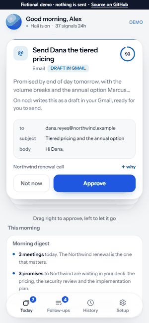
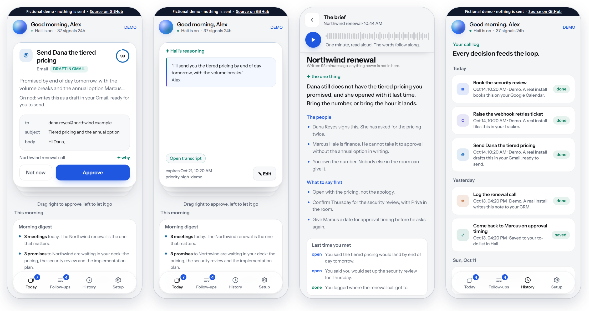

<h1 align="center">Haii</h1>

<p align="center"><strong>It keeps the promises you make in meetings.</strong></p>

<p align="center">Haii reads a meeting transcript, finds what you said you would do, and shows each promise as a card with the exact sentence you said. Approve a card and Haii drafts the email, books the meeting or files the ticket in the tools you connect.</p>

<p align="center">
<a href="https://ardaasaroglu.github.io/haii/"><strong>Try the live demo</strong></a> ·
<a href="#run-it">Run it locally</a> ·
<a href="#how-it-works">How it works</a> ·
<a href="SECURITY.md">Security</a> ·
<a href="CONTRIBUTING.md">Contributing</a>
</p>

<p align="center"><a href="https://github.com/ardaasaroglu/haii/actions/workflows/ci.yml"></a></p>

<p align="center"></p>

> **Status: early.** The core loop works end to end on your own machine with your own Claude API key: paste a meeting, get cards, decide, see what really happened. Haii does not record audio. It reads a transcript you already have and sends it to Anthropic on your key. Claude is the only model it supports. Connectors are optional and the least tested part. The live demo runs on a fictional week, needs no key and sends nothing.

## Why it exists

Every meeting ends with promises. "I'll send it over." "I'll set that up." "Leave it with me."

Notes tools write those down and stop. The promise is recorded and still not kept. Haii is built around the other half, the follow-through.

General agents take any task. Haii takes one: the commitments you make out loud. That is why the list of actions is closed, why every card carries its quote, and why it would rather tell you something was not sent than let you believe it was.

## How it works

1. **It reads the meeting.** Paste a transcript, or connect Google or a notetaker and it reads your meeting notes on its own.
2. **It finds what you promised.** Your commitments, not everyone else's. Each one becomes a card: an email to draft, a meeting to book, a message to post, a document to write, a to-do.
3. **Every card shows its evidence.** Tap a card and it turns over to the sentence you said, word for word. Press Open transcript and the meeting opens with that sentence marked.
4. **You decide with one gesture.** Swipe right or press Approve and it happens. Swipe left or press Not now, then choose to bring it back later or drop it. To change a card first, tap it and press Edit. Either way you get a few seconds to undo.
5. **It tells you what really happened.** Drafted, booked, posted, or not sent and why. Never a silent success.
6. **It briefs you before the next one.** With your calendar connected, it tells you what you promised these people last time and what is still open.



## The rules it holds itself to

* **Every card quotes something you actually said.** A quote that cannot be found word for word in the transcript is stripped before you ever see it, and a card left with no quote is dropped. Fragments under twelve characters are too short to check either way, so they are kept.
* **No action without a gesture.** There is no setting that sends or books on its own.
* **A closed list of actions.** Ten typed actions, not an open-ended agent: calendar event, email draft, to-do, Slack message, Jira issue, document, file share, CRM note, tracker task, text message.
* **Receipts tell the truth.** Each receipt says what happened: drafted in Gmail, booked, posted, filed, or not sent and why. A to-do kept in Haii's own list shows as saved, not done.
* **Other people's text never runs anything.** Cards come only from meeting transcripts and your own Slack messages. Invites, emails and other pages are context for briefs. A transcript holds everyone's words, so every card waits for your approval, and a card addressed to someone outside the meeting and outside your company says so first.

## Run it

You need Node 22 or newer. To read a real meeting you also need your own Claude API key. The live demo needs neither.

```bash
git clone https://github.com/ardaasaroglu/haii.git
cd haii
npm install
npm run dev
```

The first start writes `server/.env` with an encryption key. Create an API key at <https://platform.claude.com>, add it to that file, then stop the server and start it again.

```bash
ANTHROPIC_API_KEY=sk-ant-...
```

Open <http://localhost:4820>. The first screen asks what people call you in a meeting, because Haii needs to know which speaker is you. Then go to Setup and paste a meeting under "Read a meeting now". It needs at least 500 characters once timestamps and notes boilerplate are removed. Your cards arrive in the deck.

There is no database to install. Postgres is embedded and lives in `server/.data`.

**Just looking?** Open <http://localhost:4820/?demo>, or the [live demo](https://ardaasaroglu.github.io/haii/). Both run this same interface on a fictional week and need no key.

## Your Claude key

The key stays on your machine and is only ever sent to Anthropic. Calls are billed to it. The default model is `claude-sonnet-5-5`. Daily spend caps are on by default: past $0.75 in a day most calls move to the cheaper `claude-haiku-4-5`, and at $1.50 Haii pauses its Claude calls until the next day. Change the caps in `server/.env`, see `server/.env.example`. Until a key is set, Setup says so.

This release was run against the live Claude API: a pasted meeting came back as cards, each with a word-for-word quote, and a brief was written for the next meeting. In that check a pasted ten-line meeting cost about 2 US cents on `claude-sonnet-5-5`. If a call fails, because of a wrong key or an empty balance, the app says so in a sentence.

## Connect your tools

All optional. Without any of them, pasting a transcript still gives you cards, and to-dos still work.

| Tool | What it adds | What you need |
| --- | --- | --- |
| Google | Reads your calendar, Google Docs whose name says transcript, meeting notes or Notes by Gemini, and the sender, subject and preview line of recent mail. Books events, writes Gmail drafts and documents | Your own OAuth client, see below |
| Slack | Posts messages. Turns promises in your own Slack messages into cards. Reads your DMs and the channels you name, as context | A user token, see below |
| Jira and Confluence | Files issues, reads your issues and pages for context | Your email, an API token and your site, pasted in Setup. A default project in `JIRA_PROJECT` in `server/.env` |
| Fireflies, Fathom, Otter | Transcripts from your notetaker | An API key pasted in Setup. Otter gives API keys on its Enterprise plan only |
| Linear, Asana | Files tasks where your team already works | A personal API key or token, pasted in Setup |
| HubSpot, Salesforce | Writes CRM notes | A token pasted in Setup. Salesforce also needs your instance URL |
| Telegram | Alerts to your own chat: the server started or crashed, a job failed, a spend cap was hit. Briefs by Telegram do not work on a local run | `TELEGRAM_BOT_TOKEN` and `TELEGRAM_ADMIN_CHAT_ID` in `server/.env` |

**Google.** In Google Cloud, enable the Gmail, Google Calendar, Google Drive and Google Docs APIs. Create an OAuth client of type Web application with the redirect URI `http://localhost:4820/auth/google/callback`. With a personal Google account the consent screen is External: leave it in Testing and add your own address as a test user. Google then ends the grant after 7 days, so expect to reconnect Google in Setup once a week. A Workspace account can make the client Internal instead. Put `GOOGLE_CLIENT_ID` and `GOOGLE_CLIENT_SECRET` in `server/.env`, restart, and press Connect Google in Setup.

**Slack.** Create a Slack app, add these user token scopes and install it to your workspace: `chat:write`, `channels:history`, `channels:read`, `groups:history`, `groups:read`, `im:history`, `im:read`, `mpim:history`, `mpim:read`, `users:read`, `search:read`. Paste the user token, which starts with `xoxp-`, in Setup: open Slack under Connections, paste it and press Save and test. Connecting through your own Slack app instead needs Haii served over https, because Slack only accepts https redirect URLs.

Credentials you add in Setup, pasted or granted through a sign-in, are stored encrypted with AES-256-GCM. The key is in `server/.env` on the same machine, so this protects a copied database, not a stolen laptop. Values you put in `server/.env` yourself stay there in plain text. Connectors are the least tested part of this release, so expect rough edges and please [report them](https://github.com/ardaasaroglu/haii/issues).

## What is real and what is not

| Part | Status |
| --- | --- |
| Extraction with evidence | **Real**, on your Claude API key. |
| Deciding, undo, history, follow-ups | **Real.** |
| To-dos | **Real**, kept in Haii. |
| Email, calendar, Slack, documents, tickets | **Real when that tool is connected.** Otherwise the receipt says it was not sent, and why. |
| File share | **Limited.** It can share only a document Haii wrote. For any other file the receipt says it was not sent. |
| The demo week | **Fictional** people and meetings, answered in the browser. Nothing is read and nothing is sent. |
| Cloud mode | Managed Postgres, Google sign-in and several users are in the code, and the `Dockerfile` is for that mode. This README only covers running it for yourself. |

## Privacy

Haii runs on your machine and keeps its data in `server/.data`. It does not record audio, and it has no analytics and no telemetry. What leaves the machine:

* **To Anthropic, on your key:** the transcripts Haii reads. With Slack connected, your own recent Slack messages and the few messages before each one. With tools connected, what a brief or the morning digest is written from: the invite, attached documents, and short snippets from your mail and other tools. A meeting read also carries the facts Haii keeps about you, your open cards and how you decided on recent cards. A brief also carries those facts, your open cards and to-dos, and how you rated recent briefs. Once a week, a summary of your recent decisions and ratings, with any notes you wrote about briefs, so it can learn your preferences.
* **To a tool you connected:** the requests that read from it, and an action you approved.
* **To Telegram:** alerts, only if you set them up.

A brief read aloud uses a voice your browser provides, and some browsers provide online voices. [SECURITY.md](SECURITY.md) lists exactly what each job sends and says how to report a problem.

## How it is built

```text
┌───────────────────────────────────────────────────────────────┐
│  server/public/index.html     one file, no framework          │  deck, swipe, briefs, history
├───────────────────────────────────────────────────────────────┤
│  server/src                   TypeScript on Node, Hono        │  extraction, executor, scheduler
├──────────────────┬─────────────────────┬──────────────────────┤
│  PGlite          │  Claude             │  your tools          │  embedded Postgres · your key · optional
└──────────────────┴─────────────────────┴──────────────────────┘
```

* **Prompts are versioned files.** `server/src/prompts/extract.v011.ts` is the current extraction prompt. The earlier versions it builds on ship beside it, and each says why it exists. Every card is stamped with the version that produced it.
* **The card contract lives in one place.** `packages/schema` defines every action type and its payload.
* **Done is defined in one place.** `server/src/lib/metrics.ts` decides what counts as done. A to-do kept in Haii does not count.
* **No build step.** `tsx` runs the TypeScript directly.

| Command | What it does |
| --- | --- |
| `npm run dev` | Starts the app on port 4820. |
| `npm test` | Schema and server tests. Fast, and no database needed. |
| `npm run demo:build` | Rebuilds the hosted demo in `docs/`. |

`CLAUDE.md` holds the invariants and the traps already hit in this codebase, for anyone working on it with a coding agent.

## Contributing

Small, focused changes are welcome. Read [CONTRIBUTING.md](CONTRIBUTING.md) first. To report a security problem, see [SECURITY.md](SECURITY.md). If Haii is useful to you, a star or an [issue](https://github.com/ardaasaroglu/haii/issues) about a rough edge both help.

Sister project: [Haii Trips](https://github.com/ardaasaroglu/haii-trips) turns a conversation about a trip into a deck of cards built from each person's own words.

## License

MIT. See [LICENSE](LICENSE).

The Instrument Sans font files are included under the SIL Open Font License 1.1, see [THIRD_PARTY_NOTICES.md](THIRD_PARTY_NOTICES.md). Product names and logos of the tools Haii connects to belong to their owners and only identify those tools. Haii is not affiliated with any of them.
